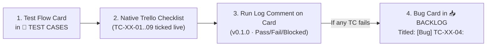

# Synkro Master QA & Test Flow Plan (OHA Standard)

**Target Release:** Synkro v0.1.0 (Android Beta Cohort)  
**Methodology:** Behavior-Driven `Given · When · Then` Flow Cards (modeled on OHA QA Standard)  
**Locations:**
1. **Git Repository:** `docs/QA_TEST_PLAN.md` (Version-controlled source of truth for developers & AI agents)
2. **Trello Board:** `🧪 TEST CASES` column (`6aca8cc19c6243edcf2ace3e`) on **Synkro — Source of Truth** (`6aca8cb4799f7f77d9680b8b`)

---

## 1. Recommended QA Tracking System (No Linear Required)

Since the team uses **Trello + GitHub** without Linear, the most reliable, zero-friction way to track test runs is a **3-part Trello-Native QA Loop**:

### How It Works in Practice:
1. **Native Trello Checklist per Card:** Every `TEST — ...` card in `🧪 TEST CASES` has an interactive Trello checklist where each item is one test case (`TC-BLD-01`, `TC-BLD-02`, etc.).
2. **Release Run Comment:** Each time a build (e.g., `v0.1.0`) is tested, the tester posts a standardized comment on the test card:
   > **Run:** `v0.1.0` · **Date:** `2026-11-02` · **Env:** `Windows 11 Clean VM + Pixel 8`  
   > **Result:** `8 Pass · 1 Fail (TC-BLD-04) · 0 Blocked`  
   > **Bug Filed:** `#124`
3. **1-to-1 Bug Card Linking:** Every failed `TC` immediately becomes its own card in `📥 BACKLOG` (or `🎯 THIS WEEK` if P0) prefixed with the exact test ID (e.g., `[Bug] TC-BLD-04 — ...`) containing:
   - Steps to reproduce
   - Expected vs. Actual
   - OS / Device / Server `req-*` ID

---

## 2. Best-Practice Flow Architecture (10 Flows, 3 Priority Tiers)

Rather than mixing everything into one giant checklist or splitting into 30 tiny cards, **10 cohesive user-journey flows** (15–20 minutes each) cover 100% of Synkro's desktop, preview, AI agent, cloud build, and web surfaces.

| Tier | Flow # | Prefix | Trello Card Title | Primary Target |
| :--- | :--- | :--- | :--- | :--- |
| **P0 Gate** | **01** | `TC-INS` | `TEST — Clean-Machine Install, First Boot & Auto-Update` | Windows 11 Clean VM |
| **P0 Gate** | **02** | `TC-AUT` | `TEST — Auth, Session Lifecycle & Security Guardrails` | Desktop + Prod Server |
| **P0 Gate** | **03** | `TC-SCF` | `TEST — Project Scaffolding (Flutter Managed/CLI & Expo)` | Desktop Workspace |
| **P0 Gate** | **04** | `TC-BLD` | `TEST — Cloud Build, Release Signing & QR APK Install` | Desktop + Server + Android Phone |
| **P1 Core** | **05** | `TC-PRV` | `TEST — Live Device Preview, Safe-Area & Icon Contrast` | Desktop Simulator (All 6 Devices) |
| **P1 Core** | **06** | `TC-AGT` | `TEST — AI Agent Chat, Proposed Edits & Spend Caps` | Desktop Chat + AI Gateway |
| **P1 Core** | **07** | `TC-EDT` | `TEST — Live Explorer, Monaco Editor & Terminal Safety` | Desktop IDE Panels |
| **P1 Core** | **08** | `TC-CHK` | `TEST — Session Checkpoints, Restore & Disk Pruning` | Desktop Git/Checkpoint Engine |
| **P2 Polish** | **09** | `TC-LOC` | `TEST — Localization (EN / AR / TR), RTL & AI Language` | Desktop UI + Agent |
| **P2 Web** | **10** | `TC-WEB` | `TEST — Website Funnel, Account Portal & Billing Webhooks` | Production Website + Server |

---

## 3. Full Specification of All 10 Test Flow Cards

---

### Flow 01: Clean-Machine Install, First Boot & Auto-Update (`TC-INS`)

> **WHY**  
> Developer machines hide missing-runtime bugs because Node.js, Git, and Flutter are globally installed. Our first 5 cohort users will install `Atomvs-Setup-0.1.0.exe` on clean Windows PCs. A defect here prevents the user from even opening the app.
>
> **DONE**  
> Every TC below run on a clean Windows 10/11 VM (no Node, Git, or Flutter installed). Result recorded in the card checklist + comment log, and each failure logged as its own card in `📥 BACKLOG`: steps to reproduce, expected vs actual, Windows version + installer version.
>
> **REF** — Card 66 (`[R5] v0.1.0 Release`), Card 67 (`[R7] Clean Machine`), Card 73 (`[R6] Auto-Update`), `DEC-03` (Unsigned `.exe`)

- **TC-INS-01** · Given a clean Windows 11 machine without dev tools · When the user downloads and runs `Atomvs-Setup-0.1.0.exe` · Then Windows SmartScreen shows 'Windows protected your PC', and clicking 'More info → Run anyway' launches the installer cleanly
- **TC-INS-02** · Given the installer finishes · When Synkro launches for the first time · Then the window opens without any `require('../index')`, missing DLL, or `node.exe not found` crash
- **TC-INS-03** · Given the production packaged build · When the main workspace or auth screen renders · Then no `DEV` badge or development debug overlay is visible anywhere in the UI
- **TC-INS-04** · Given app startup · When the background auto-update check runs with no new release available · Then it stays completely silent (no toast, modal, or error banner shown to the user)
- **TC-INS-05** · Given the user clicks 'Check for Updates' in Settings when on the latest version · When the check completes · Then a clear confirmation message states the app is up to date
- **TC-INS-06** · Given a newer version (`v0.1.1`) published on `atomvs-releases` · When the background updater detects and downloads it · Then a non-intrusive 'Update Ready — Restart to Apply' prompt appears
- **TC-INS-07** · Given the taskbar and window chrome on Windows · When Synkro is running and pinned · Then the colored Synkro icon renders sharply in the taskbar, title bar, and Alt+Tab switcher
- **TC-INS-08** · Given the user clicks 'New Window' from the menu · When the second window spawns · Then it initializes cleanly without crashing the main process or corrupting telemetry

**Owner:** Ahmed Amr / Abdullah · **Reviewer:** Ahmad · **Deadline:** Before Cohort 1 Invite (`🎯 THIS WEEK`)

---

### Flow 02: Auth, Session Lifecycle & Security Guardrails (`TC-AUT`)

> **WHY**  
> Auth gates every cloud capability (AI Gateway, Cloud Build, Usage Budgets). If dev-bypass leaks into production or session tokens are mishandled, either unauthorized users drain AI credits or real users get locked out mid-session.
>
> **DONE**  
> Every TC below run against the production server (`SYNKRO_SERVER_URL`). Result recorded on this card, and each failure logged as its own P0 card in `📥 BACKLOG`: steps to reproduce, expected vs actual, OS + server log snippet.
>
> **REF** — Card 24 & 96 (`Remove Dev Auth Bypass`), Card 32 (`Stop Logging Tokens`), Card 97 & 98 (`Login UI & Starfield`)

- **TC-AUT-01** · Given an unauthenticated desktop app · When the app boots · Then the Synkro Login screen opens with the live purple starfield, animated agent preview, and email/password inputs
- **TC-AUT-02** · Given the Sign Up mode · When the user submits an invalid email or a password under 8 characters · Then submission is blocked inline with a clear validation error
- **TC-AUT-03** · Given valid new user credentials · When the user clicks 'Create Account' · Then the account is created, the login transition effect plays, and the user lands on the Workspace screen
- **TC-AUT-04** · Given an existing account · When the user enters the wrong password · Then login fails with 'Invalid email or password' and no session token is stored
- **TC-AUT-05** · Given an authenticated session · When the app is closed and relaunched · Then the session persists securely and bypasses the login screen
- **TC-AUT-06** · Given an active session · When the user's session token expires or is revoked on the server · Then the next AI or Cloud Build request returns `401`, clears local auth state, and redirects cleanly to the Login screen
- **TC-AUT-07** · Given production mode (`NODE_ENV=production`) · When `SYNKRO_DEV_AUTH_BYPASS=true` is set in the environment · Then both desktop and server ignore the flag and strictly enforce real authentication
- **TC-AUT-08** · Given auth and AI requests in flight · When inspecting desktop renderer logs (`electron-log`) and IPC payloads · Then neither raw session tokens nor provider API keys (`sk-*`, `AIza*`) ever appear in plaintext
- **TC-AUT-09** · Given an authenticated user · When the user clicks 'Sign Out' in Settings · Then the token is wiped locally, active streams stop, and the Login screen appears

**Owner:** Abdullah · **Reviewer:** Ahmad · **Deadline:** Before Cohort 1 Invite (`🎯 THIS WEEK`)

---

### Flow 03: Project Scaffolding — Flutter & Expo (`TC-SCF`)

> **WHY**  
> Project creation is Step 1 of building an app. If templates fail to scaffold, use `com.example.*` (rejected by Google Play), or show cryptic `cmd.exe` errors when local SDKs are missing, the user abandons Synkro in the first 2 minutes.
>
> **DONE**  
> Every TC below run on Windows (both with and without local Flutter SDK in `PATH`). Result recorded on this card, and each failure logged in `📥 BACKLOG` with template name, mode, and console output.
>
> **REF** — Card 116 (`Flutter Advanced Templates & --org`), Card 117 (`Managed Flutter Missing SDK UX`), `EPIC #14` (`RN & Expo`)

- **TC-SCF-01** · Given the Welcome / New Project dialog · When the user selects 'Flutter (Managed)' and enters a project name · Then the project scaffolds from bundled templates without requiring local Flutter CLI
- **TC-SCF-02** · Given 'Flutter (Advanced / Local CLI)' selected · When the user picks a specific template (e.g., Counter, E-Commerce, Blank) · Then the scaffolded `lib/main.dart` matches the chosen template and `test/widget_test.dart` compiles cleanly
- **TC-SCF-03** · Given any new Flutter project creation · When inspecting `android/app/build.gradle` · Then `applicationId` uses `--org com.atomvs.<project>` and never `com.example.*`
- **TC-SCF-04** · Given a machine WITHOUT local Flutter SDK installed · When the user opens a Flutter project and starts Local Preview · Then a friendly setup guidance banner appears instead of raw `'flutter.bat' is not recognized`, and the misleading 'Auto-Fix Build' button is suppressed
- **TC-SCF-05** · Given the New Project dialog · When the user selects 'Expo / React Native' · Then an Expo SDK 51 project scaffolds with Fast Refresh enabled on web and valid `app.json`
- **TC-SCF-06** · Given an Expo project · When the agent or user runs `npm install <package>` · Then Synkro automatically routes it through `npx expo install <package>` to preserve SDK version compatibility
- **TC-SCF-07** · Given the project name input · When the user enters spaces, uppercase letters, or reserved Dart/JS keywords · Then inline validation normalizes or blocks the name before scaffolding starts
- **TC-SCF-08** · Given scaffolding completion · When the workspace opens · Then the File Explorer tree populates immediately and `main.dart` or `App.tsx` opens in the editor

**Owner:** Abdullah · **Reviewer:** Ahmad · **Deadline:** Before Cohort 1 Invite (`🎯 THIS WEEK`)

---

### Flow 04: Cloud Build, Release Signing & QR APK Install (`TC-BLD`)

> **WHY**  
> Cloud Build is Synkro's core magic: turning code on a Windows PC into a signed, installable Android APK via a single QR scan. A defect here breaks the core promise of the beta, wastes Docker server compute, or delivers an APK Android refuses to install.
>
> **DONE**  
> Every TC below run for both a Flutter project and an Expo project against the Linux production build worker, plus scanned and installed on a physical Android phone. Result recorded on this card; failures logged in `📥 BACKLOG` with job UUID and build log.
>
> **REF** — Card 29 (`TC-BUILD-01`), Card 101 (`Release Signing`), Card 104 (`Linux Session`), Card 108 (`QR Code`), Card 22 & 34 (`Upload/Download Hardening`)

- **TC-BLD-01** · Given a valid Flutter or Expo project · When the user clicks 'Build APK' · Then the project is zipped (excluding `node_modules`, `.git`, `build`), uploaded to `/build`, and status changes to `queued` → `running`
- **TC-BLD-02** · Given an invalid upload (non-ZIP MIME type or extracted size > 500MB) · When submitted to the build endpoint · Then the server rejects the payload immediately with `400/413` and cleans up temp files
- **TC-BLD-03** · Given a running Cloud Build · When the Docker sandbox executes on the server · Then build logs stream live to the desktop Build drawer and sandbox egress blocks unauthorized non-allowlisted domains
- **TC-BLD-04** · Given a running Cloud Build · When the user clicks 'Cancel Build' · Then the worker terminates the Docker container within 5 seconds, updates DB status to `cancelled`, and prevents natural completion from overwriting `cancelled`
- **TC-BLD-05** · Given a build that finishes compiling · When the worker signs the artifact · Then it signs with the project's persisted encrypted release keystore (never `debug.keystore`) and passes `apksigner verify`
- **TC-BLD-06** · Given build status = `success` · When the build drawer updates · Then a scannable QR code, build duration, APK size, and 'Download APK' button are displayed
- **TC-BLD-07** · Given the displayed QR code · When the user scans it with a physical Android phone camera · Then the phone browser downloads the `.apk` directly via the signed single-use/time-bound `/download/:token` URL without requiring login on the phone
- **TC-BLD-08** · Given the downloaded APK on the Android phone · When the user taps 'Install' · Then Android installs and launches the app cleanly with no 'App not installed / corrupt package' error
- **TC-BLD-09** · Given a `/download/:token` URL with a malformed UUID or expired timestamp · When requested · Then the server returns `400/404` cleanly without crashing the stream handler

**Owner:** Abdullah / Ahmed Amr · **Reviewer:** Ahmad · **Deadline:** Before Cohort 1 Invite (`🎯 THIS WEEK`)

---

### Flow 05: Live Device Preview, Safe-Area & Icon Contrast (`TC-PRV`)

> **WHY**  
> The simulator frame is where users visually verify their app. If status-bar icons are invisible (dark grey `#1c1c1e` on a dark `#000` app), flicker during scrolling, or overlap the Dynamic Island/notch, the preview looks broken even when the user's code is right.
>
> **DONE**  
> Every TC below verified across iPhone 15 Pro, iPhone SE, Pixel 8, and Galaxy S24 in Portrait and Landscape, using both a dark app (School Planner) and a light app. Failures logged in `📥 BACKLOG` with screenshot + `[preview]` console line.
>
> **REF** — Card 88 (`Xcode Status Bar`), Card 119 (`Status-Bar Icon Contrast & Hysteresis`), `usePreviewSafeArea.ts`, `preview-safe-area.ts`

- **TC-PRV-01** · Given a preview starting or switching URLs · When the iframe has not yet rendered pixels over the `#000` black underlay · Then the status bar and home indicator default to `'light'` (crisp white `#ffffff` icons, 21:1 contrast)
- **TC-PRV-02** · Given an Expo app with default `<StatusBar style="auto" />` and a dark background (`#121212`) · When running on a Windows PC set to Light OS mode · Then `style="auto"` defers to pixel sampling and renders white `#ffffff` status-bar icons (not dark grey)
- **TC-PRV-03** · Given an app with explicit `<StatusBar style="dark" />` or `barStyle="dark-content"` · When rendered over any background · Then the explicit declaration wins and icons render in `#1c1c1e`
- **TC-PRV-04** · Given a light-themed app (`#ffffff` background) with no explicit status-bar declaration · When pixel sampling runs · Then median luminance (> `0.235`) switches status-bar and home-indicator tones to `'dark'` (`#1c1c1e`, 17:1 contrast)
- **TC-PRV-05** · Given an app scrolling across mid-grey boundary backgrounds (`luminance` between `0.175` and `0.235`) · When continuous sampling runs · Then the hysteresis deadband latches the current tone and prevents rapid icon flickering
- **TC-PRV-06** · Given rapid scrolling or screen-transition animations · When mutations fire during an active 150ms sample timer · Then the trailing-edge sampler captures the final settled frame 50ms after completion
- **TC-PRV-07** · Given device switched between iPhone 15 Pro (Dynamic Island), iPhone SE (classic), and Pixel 8 (Android punch-hole) · When rendered in Portrait and Landscape · Then safe-area insets (`var(--atomvs-safe-area-inset-*)`) update live and content never clips under the notch or gesture bar
- **TC-PRV-08** · Given an app inside the preview iframe · When scrolling vertically · Then native desktop scrollbars are hidden while wheel/trackpad scrolling remains smooth
- **TC-PRV-09** · Given a runtime crash or Expo redbox inside the preview iframe · When the agent calls `get_preview_logs` · Then the exact exception and redbox overlay text are captured and returned to the agent

**Owner:** Abdullah · **Reviewer:** Ahmad · **Deadline:** Nov 2, 2026 (`🎯 THIS WEEK`)

---

### Flow 06: AI Agent Chat, Proposed Edits & Spend Caps (`TC-AGT`)

> **WHY**  
> The AI Agent is the brain of Synkro. If proposed edits auto-apply without permission, `Proceed` buttons appear on plain questions, or spend caps fail to stop runaway loops, user code gets corrupted or server AI budgets get wiped out.
>
> **DONE**  
> Every TC below run in the Desktop Chat Pane with real agent turns. Result recorded on this card; failures logged in `📥 BACKLOG` with thread ID and agent step log.
>
> **REF** — Card 48 (`First-Cohort AI Spend Cap`), Card 94 (`Ctrl+L to Chat`), Commit `9659efc` (`Compact Changed-Files & Proceed Button`)

- **TC-AGT-01** · Given an open file in Monaco Editor with lines highlighted · When the user presses `Ctrl+L` · Then the selected code range and file path are attached as context chips in the Chat input box
- **TC-AGT-02** · Given the user asks a conceptual question (e.g., 'How does routing work in this app?') · When the agent replies without proposing plan execution · Then NO 'Proceed' button is shown
- **TC-AGT-03** · Given the agent generates an implementation plan that requires user approval · When the plan card renders · Then the 'Proceed' button is displayed and clicking it starts execution
- **TC-AGT-04** · Given the agent modifies multiple files during a run · When the turn completes · Then a compact changed-files summary list renders with clickable file links and diff stats
- **TC-AGT-05** · Given proposed file edits from the agent · When the user reviews the diff and clicks 'Accept' or 'Reject' · Then 'Accept' writes the changes cleanly to disk, while 'Reject' reverts the file to its pre-edit state
- **TC-AGT-06** · Given an agent modifying app code · When the agent finishes editing · Then the 'verify-before-claiming' rule forces the agent to check diagnostics/preview logs before claiming the task is done
- **TC-AGT-07** · Given an active agent generation stream · When the user clicks the 'Stop' button · Then the LLM stream and any running agent tool command abort immediately
- **TC-AGT-08** · Given a user whose monthly/cohort AI spend reaches the configured budget cap · When they send another prompt · Then `ServerBudgetGuard` blocks the request with `402/429` and displays a clear budget limit notice
- **TC-AGT-09** · Given a transient `503` or rate-limit error on the primary AI model provider · When a request is made · Then the gateway fails over to the secondary model automatically, whereas permanent `400/401` errors fail fast without retrying

**Owner:** Abdullah · **Reviewer:** Ahmad · **Deadline:** Nov 2, 2026 (`🎯 THIS WEEK`)

---

### Flow 07: Live Explorer, Monaco Editor & Terminal Safety (`TC-EDT`)

> **WHY**  
> Synkro is a full IDE. If files created by the agent don't appear in the Explorer without a manual refresh, if switching tabs kills the running dev server terminal, or if the agent can run destructive shell commands, the IDE feels broken or unsafe.
>
> **DONE**  
> Every TC below run in the Desktop IDE across Explorer, Editor, and Terminal panels. Failures logged in `📥 BACKLOG`.
>
> **REF** — Card 83 (`Terminal Persistence on Tab Switch`), Card 86 (`Terminal Design + Run Tab`), Commit `9659efc` (`Live Explorer`)

- **TC-EDT-01** · Given a project open in the Explorer · When the AI agent or an external process creates, renames, or deletes a file on disk · Then `file-watcher` updates the Explorer file tree live within 1 second without collapsing open folders
- **TC-EDT-02** · Given multiple files opened from the Explorer · When the user edits a file · Then an unsaved dot indicator appears on the tab, and `Ctrl+S` saves the file to disk and triggers hot reload
- **TC-EDT-03** · Given an interactive shell running in the Terminal panel · When the user switches bottom panel tabs (e.g., to `Problems` or `Run` output) and switches back · Then the terminal session, scrollback buffer, and running process remain alive
- **TC-EDT-04** · Given the AI agent executes a shell command (`agent-cmd-*`) · When the command starts · Then the bottom panel opens automatically, routes output to a single read-only 'Agent Terminal' tab, and blocks keyboard input in that tab
- **TC-EDT-05** · Given a multiple-command turn by the agent · When each command finishes · Then an exit code separator (`Exit code: 0` or non-zero) is injected into the Agent Terminal stream
- **TC-EDT-06** · Given an agent command producing > 50KB of stdout · When the command finishes · Then the full output renders in the Terminal UI while the LLM receives a safely truncated 50KB tail buffer
- **TC-EDT-07** · Given the agent attempts a destructive command (e.g., `rm -rf /`, formatting drives, or escaping the workspace root) · When safety validation runs · Then the command is blocked before execution with a security error

**Owner:** Abdullah · **Reviewer:** Ahmad · **Deadline:** Nov 2, 2026 (`🎯 THIS WEEK`)

---

### Flow 08: Session Checkpoints, Restore & Disk Pruning (`TC-CHK`)

> **WHY**  
> AI agents can occasionally make sweeping changes that break an app. Checkpoints are the user's safety net ("time machine"). If restore leaves orphan files or if checkpoints fill up the user's hard drive without pruning, trust is lost.
>
> **DONE**  
> Every TC below verified on a multi-file workspace on Windows NTFS. Failures logged in `📥 BACKLOG`.
>
> **REF** — `session-checkpoints.test.ts`, Workspace Checkpoint Service

- **TC-CHK-01** · Given an active coding session · When the user sends a prompt that triggers file modifications · Then a snapshot checkpoint is created automatically before the agent writes to disk
- **TC-CHK-02** · Given a checkpoint created before an agent turn · When the agent modifies 3 files, creates 1 new file, and deletes 1 file, and the user clicks 'Restore Checkpoint' · Then the 3 modified files revert, the 1 created file is removed, and the 1 deleted file is restored
- **TC-CHK-03** · Given a workspace with `node_modules` and `.git` · When a checkpoint is captured · Then heavy ignored directories are excluded so checkpoint creation completes in under 1 second
- **TC-CHK-04** · Given checkpoint storage exceeding the max count or byte limit · When a new checkpoint is saved · Then the oldest checkpoints are pruned from disk automatically
- **TC-CHK-05** · Given a restored checkpoint · When the restore completes · Then the Monaco Editor reloads open buffers from disk and the Live Preview refreshes to match the restored code

**Owner:** Abdullah · **Reviewer:** Ahmad · **Deadline:** Nov 2, 2026 (`🎯 THIS WEEK`)

---

### Flow 09: Localization (EN / AR / TR), RTL & AI Language (`TC-LOC`)

> **WHY**  
> Our primary user cohorts span Arabic, Turkish, and English speakers. Partial translations, broken RTL layouts in Arabic, or an AI agent replying in English when the user speaks Arabic degrades the localized experience.
>
> **DONE**  
> Every TC below run across all 3 locales (`en`, `ar`, `tr`). Visual inspection of RTL alignment in Arabic. Failures logged in `📥 BACKLOG` with screenshot and locale key.
>
> **REF** — Card 109 (`[Desktop] Arabic + Turkish UI (i18n) and AI replies in user's language`)

- **TC-LOC-01** · Given Settings → Language · When the user selects **العربية (Arabic)** · Then the entire UI switches to Arabic immediately and document direction flips to `dir="rtl"` without requiring an app restart
- **TC-LOC-02** · Given Arabic (`rtl`) mode active · When viewing the Monaco code editor and terminal output · Then code editors, file paths, and terminal logs remain strictly `ltr` so code syntax is never reversed
- **TC-LOC-03** · Given Settings → Language · When the user selects **Türkçe (Turkish)** · Then all sidebar labels, modal buttons, settings tabs, and build status messages render in natural Turkish with no raw translation keys (`i18n.*`) showing
- **TC-LOC-04** · Given the user writes a prompt in Arabic or Turkish in the Chat pane · When the AI Agent responds · Then the agent replies in the same language as the user's prompt while keeping code identifiers in English
- **TC-LOC-05** · Given a chosen language (`ar` or `tr`) · When the user closes and restarts Synkro · Then the selected locale persists across restarts

**Owner:** Abdullah · **Reviewer:** Ahmad · **Deadline:** Nov 2, 2026 (`🎯 THIS WEEK`)

---

### Flow 10: Website Funnel, Account Portal & Billing Webhooks (`TC-WEB`)

> **WHY**  
> The website (`website/`) is the front door where invited users download the installer, read the SmartScreen bypass guide, check pricing, and upgrade their plan. Broken download links or failed payment webhooks block both user acquisition and revenue.
>
> **DONE**  
> Every TC below verified on the deployed production website and billing webhook endpoint. Failures logged in `📥 BACKLOG`.
>
> **REF** — Cards 60, 62, 63, 69, 70, 71, 72, 76 (`Website, Legal, Account, Download, Payment Webhook`)

- **TC-WEB-01** · Given a visitor landing on `/` · When clicking 'Download for Windows' · Then they land on `/download`, the `.exe` download starts, and the visual step-by-step Windows SmartScreen guide ('More info → Run anyway') is clearly displayed
- **TC-WEB-02** · Given the website navigation · When visiting `/pricing`, `/docs`, `/privacy`, and `/terms` · Then all pages render cleanly on both desktop and mobile viewports with zero broken links or `404` assets
- **TC-WEB-03** · Given an authenticated user visiting `/account` and `/account/billing` · When the page loads · Then their current plan tier (Free / Pro), AI usage meter, and build history are accurately displayed
- **TC-WEB-04** · Given a Free-tier user clicking 'Upgrade to Pro' · When the Lemon Squeezy / Stripe checkout completes · Then the signed webhook hits the server, verifies the HMAC signature, and upgrades the user's DB plan tier immediately
- **TC-WEB-05** · Given a forged webhook payload with an invalid HMAC signature · When POSTed to the server webhook route · Then the server rejects it with `401/403` and does not modify user plan state

**Owner:** Abdullah · **Reviewer:** Ahmad · **Deadline:** Nov 2, 2026 (`🎯 THIS WEEK`)
